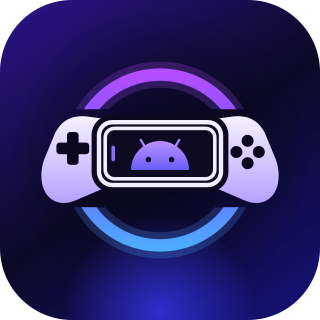

<p align="center">
  
</p>

<h1 align="center">PocketDeck for PC</h1>

<p align="center">
  Your PC games, on your phone. The Windows companion to <a href="https://github.com/Pocket-Deck-App/Pocket-Deck-Android">PocketDeck</a>.
</p>

PocketDeck for PC gets a Windows gaming PC ready to stream to [PocketDeck](https://github.com/Pocket-Deck-App/Pocket-Deck-Android) on your phone. It sets up the streaming engine ([Sunshine](https://github.com/SunshineStream/Sunshine)), finds the games you have installed and puts them on your phone with their covers, and pairs your phone with one scan. Then it waits quietly in the tray, and your phone can play from it at home or anywhere else.

It's built to be light: pure Rust with a [Slint](https://slint.dev) interface drawn by the software renderer, about 30 MB of memory with the window open and less in the tray. It looks, sounds and sets up like PocketDeck on the phone, so the two feel like one product.

## Features

- **Play from anywhere:** stream on mobile data, at a friend's place or on hotel Wi-Fi, exactly as you do at home. There's no Tailscale, VPN, port forwarding or router setup, and nothing changes on the phone: it reaches this PC the same way wherever it is. A small relay only introduces the phone and the PC to each other. **The stream itself always goes straight from the PC to the phone**, over your home network when you're home and peer to peer over the internet when you're not, so it's as fast as your connection allows and never passes through someone else's server. If a network blocks direct connections, PocketDeck says so instead of streaming through the relay. It's on by default once the virtual display is set up (**Settings → Streaming host → Play from anywhere**). Phones are allowed only while they stay paired in Sunshine. See [docs/remote-play.md](docs/remote-play.md).
- **Streaming engine setup:** uses Sunshine if it's already installed, or downloads and installs the official release (checksum-pinned) with one administrator prompt. Home shows at a glance whether it's installed, running, answering and has the controller driver ([ViGEmBus](https://github.com/nefarius/ViGEmBus)), with a fix button for each.
- **Your games, found for you:** scans Steam, Epic Games, GOG and the Xbox app / Microsoft Store from their own files and registry entries, looks through your other installed programs for games (EA app, Ubisoft Connect, Battle.net, Riot, standalone installers), and lets you add any other game by picking its `.exe`. Turn off a whole launcher or hide single games.
- **On your phone with covers:** every game becomes a Sunshine app with its cover art, so it shows up in PocketDeck's library on the phone. PocketDeck only ever edits the apps it created; anything you made in Sunshine yourself is left alone.
- **Pair with one scan:** **Devices → Pair a phone** shows a QR code. Scan it with PocketDeck on your phone (**Settings → PC streaming → Scan PC's code**) and it's paired. No PIN to type into Sunshine. The code includes the PC's certificate fingerprint, so the phone only pairs with the PC whose screen showed it. See [docs/pair-with-scan.md](docs/pair-with-scan.md).
- **Paired phones:** see every device that can stream from this PC and unpair any of them.
- **Match your phone's screen:** **Settings → Streaming host** adds a virtual display (one administrator prompt) that is switched on at your phone's exact resolution and refresh rate just before a stream starts, and off again when it ends. It's off the rest of the time, so Windows never boots onto it or opens apps on it. While you stream it's the main screen, where games open and what the phone sees; the PC's own screens stay on beside it. Games that remember another monitor are moved onto it as they open. See [docs/virtual-display.md](docs/virtual-display.md).
- **Quitting from the phone closes the game:** Steam games started from your phone close on the PC when you quit them on the phone (asked to close first, then closed if they're still running 5 seconds later).
- **Lives in the tray:** starts with Windows (optional) and keeps running when the window is closed. The window is only built while it's open.
- **Same look and sound as the phone:** guided setup, accent colours, tile shapes and sizes, and the same console-style UI sounds.

## Part of PocketDeck

PocketDeck is three repositories in the [Pocket-Deck-App](https://github.com/Pocket-Deck-App) organization:

| Repository | What it is |
|---|---|
| [Pocket-Deck-Android](https://github.com/Pocket-Deck-App/Pocket-Deck-Android) | The Android app: the game launcher and the streaming client. |
| **Pocket-Deck-PC** (this one) | The Windows companion: sets up Sunshine, puts your games on the phone, pairs with one scan and hosts play from anywhere. |
| [Pocket-Deck-Relay](https://github.com/Pocket-Deck-App/Pocket-Deck-Relay) | Deployment files for the relay that helps the phone and the PC find each other. |

## Requirements

- Windows 10 or 11, x64
- A GPU that Sunshine can encode with (NVIDIA, AMD or Intel)
- PocketDeck 0.6.0 or newer on the phone for play from anywhere (0.4.0 or newer streams on the same network)
- Play from anywhere: the virtual display set up in **Settings → Streaming host**, and the phone paired once on your home network

## Install

Download `PocketDeck-<version>.exe` from [**Releases**](https://github.com/Pocket-Deck-App/Pocket-Deck-PC/releases/latest) and run it. It's a single program with nothing to install; setup walks you through the rest. A new release is published automatically whenever the version number changes on `main`.

**If your phone can't connect, check the PC:**

- **Firewall:** Windows Defender must allow Sunshine inbound (TCP 47984, 47989, 47990, 48010 and UDP 47998–48000, 48002, 48010). If your network is marked *Public*, make sure the rule covers that profile, or mark your home network *Private*.
- **Controller:** Sunshine needs the [ViGEmBus](https://github.com/nefarius/ViGEmBus/releases) driver to create a virtual controller. Home shows whether it's there.
- **Same network (first time only):** the phone pairs and signs up for play from anywhere on the PC's own network. Some routers isolate Wi-Fi devices from each other or from wired ones.
- **"Can't reach your PC directly on this network":** the phone found the PC, but that network blocks direct connections between devices (some corporate, school and carrier networks do). Try another network or a phone hotspot. PocketDeck won't stream through the relay.

## Release notes

Full notes and downloads for every version are on the [Releases page](https://github.com/Pocket-Deck-App/Pocket-Deck-PC/releases).

### 0.3.0

- **Play from anywhere:** stream on mobile data or any Wi-Fi, with no Tailscale, VPN or router setup. The phone reaches the PC the same way at home and away. A small relay only introduces the two; the stream always goes directly between the PC and the phone, and PocketDeck refuses to stream through the relay. Switch it in **Settings → Streaming host → Play from anywhere** (on by default). Needs PocketDeck 0.6.0 on the phone.
- **Games open on the phone's screen:** games that remember another monitor (Don't Starve Together, for example) are moved onto the virtual display as they open. Windowed and borderless games follow; some exclusive full-screen games may not.
- **Quit closes Steam games:** quitting a Steam game on the phone now closes it on the PC. Sunshine couldn't follow games Steam started, so they used to keep running.
- **Home** shows what's new, with play from anywhere's live status, and the virtual display can be switched off without removing it.

### 0.2.1

- **Your monitors stay on while you stream:** the virtual display now joins your desktop as the main screen, where the phone's game opens and what the phone sees, instead of replacing your monitors. They stay on beside it, and your usual layout and main screen come back when the stream ends.
- **Pairing when the phone retries:** if your phone already has a pairing request waiting (from an earlier attempt), the PC turns that one down and answers the new one, so a retry no longer gets stuck behind its own old request.

### 0.2.0

- **Match your phone's screen:** while a phone streams, the PC switches to a virtual display at the phone's exact resolution and refresh rate, then puts your monitors back as they were when the stream ends. It's off whenever nobody is streaming, so Windows never boots onto it. Turn it on in **Settings → Streaming host** (one administrator prompt); the same switch removes it.
- **Xbox app and Microsoft Store games:** PC Game Pass and other Store games now show up in your library with their artwork.
- **Other games on your PC:** games from the EA app, Ubisoft Connect, Battle.net, Riot, itch or a standalone installer are found among your installed programs, without picking each `.exe` by hand.
- **Covers for every game:** games without box art from their launcher get a cover from [SteamGridDB](https://www.steamgriddb.com).

### 0.1.0

- First release: Sunshine setup and health checks, the game library (Steam, Epic Games, GOG and games you add) synced to your phone with covers, pairing a phone by scanning a QR code, a paired-device list, tray mode and start with Windows.

## Building from source

You need Windows and Rust. [`rust-toolchain.toml`](rust-toolchain.toml) pins Rust 1.98 (iroh, used for play from anywhere, needs 1.91 or newer), and rustup installs it on the first build.

```bash
cargo build --release
```

```bash
cargo test --workspace
```

The program is `target/release/PocketDeck.exe`. To regenerate the Windows icons after changing the logo, run `cargo run -p xtask -- icons`.

Development switches (environment variables):

- `POCKETDECK_HOME`: keep all settings and caches in this folder instead of `%APPDATA%` and `%LOCALAPPDATA%`.
- `POCKETDECK_RENDERER=femtovg`: use the GPU renderer (faster drawing, about three times the memory).
- `POCKETDECK_INTRO_SPEED=0.2`: play the startup intro in slow motion.

## Project layout

```
app/                 # The Windows app
├── src/             # Window, tray, single instance, background workers, UI sounds, pairing sessions
└── ui/              # Slint UI: pages (intro, setup, home, library, devices, settings) and components
crates/
├── core/            # Settings, app folders, start with Windows, library state, Sunshine app sync, pairing
├── display/         # Virtual display: driver, service, phone endpoint, screen layout, setup and removal
├── remote/          # Play from anywhere: the PC/phone tunnel over iroh (shared with the phone app)
├── library/         # Steam, Epic, GOG, Xbox/Store and installed-program scanners, manual games, cover art
└── sunshine/        # Finding, installing and checking Sunshine; its web API; login storage; certificate
xtask/               # Developer tasks (icon generation)
docs/                # Design notes, including the QR pairing contract shared with the phone app
```

## Credits

Designed and developed by [Abid Nafi](https://abidnafi.com) ([GitHub](https://github.com/MohammedAbidNafi)).

- Streams with [Sunshine](https://github.com/SunshineStream/Sunshine) by LizardByte and the Sunshine contributors (GPLv3), which isn't included: PocketDeck uses your install or downloads the official installer.
- Interface built with [Slint](https://slint.dev) (used under the GPLv3).
- Controller support uses [ViGEmBus](https://github.com/nefarius/ViGEmBus) by Nefarius Software Solutions, which isn't included.
- Matching your phone's screen uses [Virtual Display Driver](https://github.com/VirtualDrivers/Virtual-Display-Driver) by MikeTheTech and the VirtualDrivers contributors (MIT), which isn't included: PocketDeck downloads one pinned, checksum-verified release when you switch the feature on.
- Play from anywhere uses [iroh](https://github.com/n0-computer/iroh) by n0 (MIT / Apache 2.0) for direct connections and hole punching, with a self-hosted `iroh-relay`.
- Rust crates and their licences are listed in [`NOTICE`](NOTICE).

## Licence

PocketDeck for PC is free software under the [GNU General Public License v3](LICENSE). You may share and change it under those terms; it comes with no warranty. Third-party components and their licences are listed in [`NOTICE`](NOTICE).

## Disclaimer

PocketDeck doesn't include any games. Steam, Epic Games, GOG, Xbox and Microsoft Store are trademarks of their respective owners, as is NVIDIA GameStream. PocketDeck is an independent project and isn't affiliated with or endorsed by any of them, nor by LizardByte or the Moonlight project.
