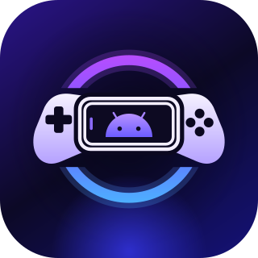

<p align="center">
  
</p>

<h1 align="center">PocketDeck for PC</h1>

<p align="center">
  Your PC games, on your phone. The Windows companion to <a href="https://github.com/MohammedAbidNafi/Pocket-Deck">PocketDeck</a>.
</p>

PocketDeck for PC gets a Windows gaming PC ready to stream to [PocketDeck](https://github.com/MohammedAbidNafi/Pocket-Deck) on your phone. It sets up the streaming engine ([Sunshine](https://github.com/SunshineStream/Sunshine)), finds the games you have installed and puts them on your phone with their covers, and pairs your phone with one scan. Then it waits quietly in the tray.

It's built to be light: pure Rust with a [Slint](https://slint.dev) interface drawn by the software renderer, about 30 MB of memory with the window open and less in the tray. It looks, sounds and sets up like PocketDeck on the phone, so the two feel like one product.

## Features

- **Streaming engine setup:** uses Sunshine if it's already installed, or downloads and installs the official release (checksum-pinned) with one administrator prompt. Home shows at a glance whether it's installed, running, answering and has the controller driver ([ViGEmBus](https://github.com/nefarius/ViGEmBus)), with a fix button for each.
- **Your games, found for you:** scans Steam, Epic Games, GOG and the Xbox app / Microsoft Store from their own files and registry entries, looks through your other installed programs for games (EA app, Ubisoft Connect, Battle.net, Riot, standalone installers), and lets you add any other game by picking its `.exe`. Turn off a whole launcher or hide single games.
- **On your phone with covers:** every game becomes a Sunshine app with its cover art, so it shows up in PocketDeck's library on the phone. PocketDeck only ever edits the apps it created; anything you made in Sunshine yourself is left alone.
- **Pair with one scan:** **Devices → Pair a phone** shows a QR code. Scan it with PocketDeck on your phone (**Settings → PC streaming → Scan PC's code**) and it's paired. No PIN to type into Sunshine. The code includes the PC's certificate fingerprint, so the phone only pairs with the PC whose screen showed it. See [docs/pair-with-scan.md](docs/pair-with-scan.md).
- **Paired phones:** see every device that can stream from this PC and unpair any of them.
- **Match your phone's screen:** **Settings → Streaming host** adds a virtual display (one administrator prompt) that is switched on at your phone's exact resolution and refresh rate just before a stream starts, and off again when it ends. It's off the rest of the time, so Windows never boots onto it or opens apps on it. While you stream it's the main screen, where games open and what the phone sees; the PC's own screens stay on beside it. See [docs/virtual-display.md](docs/virtual-display.md).
- **Lives in the tray:** starts with Windows (optional) and keeps running when the window is closed. The window is only built while it's open.
- **Same look and sound as the phone:** guided setup, accent colours, tile shapes and sizes, and the same console-style UI sounds.

### Coming next

- **Play from anywhere:** stream on mobile data or any Wi-Fi, without Tailscale or router setup. The phone connects straight to the PC; a small relay only helps the two find each other.

## Requirements

- Windows 10 or 11, x64
- A GPU that Sunshine can encode with (NVIDIA, AMD or Intel)
- PocketDeck 0.4.0 or newer on the phone, on the same network as the PC (until play-from-anywhere arrives)

## Install

Download `PocketDeck-<version>.exe` from [**Releases**](https://github.com/MohammedAbidNafi/Pocket-Deck-PC/releases/latest) and run it. It's a single program with nothing to install; setup walks you through the rest. A new release is published automatically whenever the version number changes on `main`.

**If your phone can't connect, check the PC:**

- **Firewall:** Windows Defender must allow Sunshine inbound (TCP 47984, 47989, 47990, 48010 and UDP 47998–48000, 48002, 48010). If your network is marked *Public*, make sure the rule covers that profile, or mark your home network *Private*.
- **Controller:** Sunshine needs the [ViGEmBus](https://github.com/nefarius/ViGEmBus/releases) driver to create a virtual controller. Home shows whether it's there.
- **Same network:** the phone and the PC must be on the same LAN. Some routers isolate Wi-Fi devices from each other or from wired ones.

## Release notes

Full notes and downloads for every version are on the [Releases page](https://github.com/MohammedAbidNafi/Pocket-Deck-PC/releases).

### 0.2.1

- **Your monitors stay on while you stream:** the virtual display now joins your desktop as the main screen, where the phone's game opens and what the phone sees, instead of replacing your monitors. They stay on beside it, and your usual layout and main screen come back when the stream ends.
- **Pairing when the phone retries:** if your phone already has a pairing request waiting (from an earlier attempt), the PC turns that one down and answers the new one, so a retry no longer gets stuck behind its own old request.

### 0.2.0

- **Match your phone's screen:** while a phone streams, the PC switches to a virtual display at the phone's exact resolution and refresh rate, then puts your monitors back as they were when the stream ends. It's off whenever nobody is streaming, so Windows never boots onto it. Turn it on in **Settings → Streaming host** (one administrator prompt); the same switch removes it.
- **Xbox app and Microsoft Store games:** PC Game Pass and other Store games now show up in your library with their artwork.
- **Other games on your PC:** games from the EA app, Ubisoft Connect, Battle.net, Riot, itch or a standalone installer are found among your installed programs, without picking each `.exe` by hand.
- **Covers for every game:** games without box art from their launcher get a cover from [SteamGridDB](https://www.steamgriddb.com).

### 0.1.0

- First release: Sunshine setup and health checks, the game library (Steam, Epic Games, GOG and games you add) synced to your phone with covers, pairing a phone by scanning a QR code, a paired-device list, tray mode and start with Windows.

## Building from source

You need Windows and Rust. [`rust-toolchain.toml`](rust-toolchain.toml) pins Rust 1.88 (the newest Slint that supports it is 1.16), and rustup installs it on the first build.

```bash
cargo build --release
```

```bash
cargo test --workspace
```

The program is `target/release/PocketDeck.exe`. To regenerate the Windows icons after changing the logo, run `cargo run -p xtask -- icons`.

Development switches (environment variables):

- `POCKETDECK_HOME`: keep all settings and caches in this folder instead of `%APPDATA%` and `%LOCALAPPDATA%`.
- `POCKETDECK_RENDERER=femtovg`: use the GPU renderer (faster drawing, about three times the memory).
- `POCKETDECK_INTRO_SPEED=0.2`: play the startup intro in slow motion.

## Project layout

```
app/                 # The Windows app
├── src/             # Window, tray, single instance, background workers, UI sounds, pairing sessions
└── ui/              # Slint UI: pages (intro, setup, home, library, devices, settings) and components
crates/
├── core/            # Settings, app folders, start with Windows, library state, Sunshine app sync, pairing
├── display/         # Virtual display: driver, service, phone endpoint, screen layout, setup and removal
├── library/         # Steam, Epic, GOG, Xbox/Store and installed-program scanners, manual games, cover art
└── sunshine/        # Finding, installing and checking Sunshine; its web API; login storage; certificate
xtask/               # Developer tasks (icon generation)
docs/                # Design notes, including the QR pairing contract shared with the phone app
```

## Credits

Designed and developed by [Abid Nafi](https://abidnafi.com) ([GitHub](https://github.com/MohammedAbidNafi)).

- Streams with [Sunshine](https://github.com/SunshineStream/Sunshine) by LizardByte and the Sunshine contributors (GPLv3), which isn't included: PocketDeck uses your install or downloads the official installer.
- Interface built with [Slint](https://slint.dev) (used under the GPLv3).
- Controller support uses [ViGEmBus](https://github.com/nefarius/ViGEmBus) by Nefarius Software Solutions, which isn't included.
- Matching your phone's screen uses [Virtual Display Driver](https://github.com/VirtualDrivers/Virtual-Display-Driver) by MikeTheTech and the VirtualDrivers contributors (MIT), which isn't included: PocketDeck downloads one pinned, checksum-verified release when you switch the feature on.
- Rust crates and their licences are listed in [`NOTICE`](NOTICE).

## Licence

PocketDeck for PC is free software under the [GNU General Public License v3](LICENSE). You may share and change it under those terms; it comes with no warranty. Third-party components and their licences are listed in [`NOTICE`](NOTICE).

## Disclaimer

PocketDeck doesn't include any games. Steam, Epic Games, GOG, Xbox and Microsoft Store are trademarks of their respective owners, as is NVIDIA GameStream. PocketDeck is an independent project and isn't affiliated with or endorsed by any of them, nor by LizardByte or the Moonlight project.
